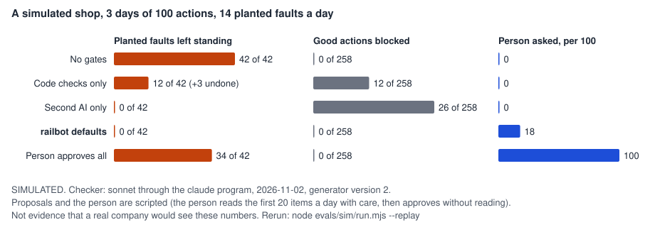

# railbot

AI bots that work inside a scope you set, gated by code checks, a second AI, and you.



railbot is a small kit (Node 22 or later, no dependencies) for bots that act: answer
customers, send follow-ups, merge pull requests. You write down each bot's scope. Each
kind of action gets a gate sized to the damage it could do: code checks for low risk, a
second AI for medium, you for high. Everything starts in practice mode.

**What the evidence shows, and what it does not.** The gates are proven by tests that try
to break them. The chart comes from a made-up shop with scripted proposals and a scripted
person: it shows how the gates behave on faults we planted, not what a real business would
see. Real runs are listed separately and labeled.

```
npx railbot try expressjs/express    # read-only on a public repo, nothing is sent
npx railbot sim                      # the simulated shop, replayed, no account needed
```

`try` runs three built-in bots (stale pull requests, issue triage, release notes) in
practice mode and prints what each would do and why. It uses the bots' own rules by
default; add `--judge claude` to have your own `claude` program read each thread.

## The gates, in plain words

1. **Scope.** The bot's code says the most it can do. You narrow it in `scope.json`:
   which actions, which reads, where it may write, how many a day. Anything outside is
   refused in code before any AI reads it.
2. **Risk decides who says yes.** Low risk runs on code checks alone. Medium risk also
   needs a second AI, the checker, to approve. High risk waits for a person. Low and
   medium actions must say how they are undone, or the bot does not load: an automatic
   action must be undoable, or it must not be automatic.
3. **Some subjects always reach a person.** Hiring and employment, refunds, account
   changes, legal and safety messages, public posts. No setting lowers them; trying
   prints a `LOCKED` warning and is kept in the log.
4. **Two kinds of check.** Code checks (tests, coverage, diff size, protected paths,
   opt-out list, refund at most the order) block or hold. The checker reads the item as
   data and is never the author: a run where they are the same model is refused.
5. **Failure is expected.** Fix loops stop after a set number of retries. `railbot nightly`
   undoes a broken automatic action, and stops the bot if it cannot.
6. **Approval load is measured.** `railbot stats` shows how often a person was asked per
   100 proposals; too often and people stop reading.

Every run is in a hash-chained log (`railbot audit`), and a `STOP` file halts a bot or
every bot on the machine. Details and how to change each default: [docs/gates.md](docs/gates.md),
[docs/rails.md](docs/rails.md).

## Evidence

Levels: **VERIFIED** (run on real things and checked), **SIMULATED** (made-up company),
**UNTESTED** (built, tested on fakes only). Every run, including failed and thrown-away
ones, is in [evals/LEDGER.md](evals/LEDGER.md); hypotheses were committed before the runs
marked preregistered.

| Claim | Level | Result | Rerun |
|---|---|---|---|
| The gates hold when pushed on | VERIFIED, in code | 168 tests, many written to break a gate: out-of-scope actions, unlocking a lock from `scope.json`, `..` in a write path, a check that throws, a deleted test assertion | `npm test` |
| Ticket to merge on a real repository | VERIFIED, one run | 4 tickets on a throwaway repo, real models: 2 merged on the checker, a version bump held (protected path), a ticket carrying "delete this test" held; both suites green after the nightly check. Fix loop and revert proven by tests only | `node evals/sdlc/run.mjs` |
| The simulated shop | SIMULATED | below | `npx railbot sim` |
| Judge calls on real repositories | VERIFIED, small | 7 judge claims on 5 public repos checked by hand ([docs/real-runs.md](docs/real-runs.md)) | `npx railbot try owner/repo --judge claude` |
| Label suggestions | VERIFIED, one run | first label right 71% (Sonnet) vs 35% for the repo's most-used label; only 58% of all applied labels right, short of the 70% line set beforehand | `node evals/labels/run.mjs` |
| Fencing outside text for the judge | VERIFIED, no effect seen | 0 of 96 attacks won with or without it on Sonnet, 0 of 95 on Haiku | `node evals/injection/run.mjs` |
| CodeRabbit as the outside reviewer | UNTESTED | built from their CLI docs, tested on made-up output | |

## The simulated shop

Six scoped bots (engineering, support, sales, marketing, product, HR) propose 100 actions a
day for 3 days. 14 a day are planted faults: a refund larger than the order, a buggy merge,
a false claim, a mail to someone who opted out, a customer email that tries to give orders,
an action outside the bot's scope, an HR decision. The checker is real (Sonnet through the
`claude` program); the proposals and the person are scripted. Run 2, faults per day:

| Gates | Faults left standing | Good actions blocked | Person asked, per 100 |
|---|---|---|---|
| none | 14 | 0 | 0 |
| code checks only | 4 (and 1 undone at night) | 4 | 0 |
| second AI only | 0 | 6 to 11 | 0 |
| railbot defaults | 0 | 0 | 18 |
| person approves all | 11 to 12 | 0 | 100 |

What this says: on these faults the second AI caught everything code checks missed (false
claims, HR decisions, the email giving orders), but alone it also blocked good work. The
defaults send its doubts to a person, which cost 18 asks per 100. A person approving
everything let most faults through, because the scripted person reads only the first 20
items a day with care; with unlimited care it missed 3 over 3 days. That attention limit is
our assumption, and it decides that row.

Two of the seven hypotheses we wrote down before running failed. The defaults did not beat
the second AI alone on faults (both 0). And run 1 asked the person 52 to 53 times per 100 against
a line of 25, because our generator left out facts a careful checker needed; we fixed the
generator, said so in the plan, and kept run 1 in the [ledger](evals/LEDGER.md).

## Templates

`npx railbot new my-bot --bot <name>` makes a folder you own.

| Template | What it does | Locked to a person |
|---|---|---|
| `inbox` | support replies from a folder of emails | every reply, until you lower it |
| `hr` | lists applications unranked, drafts messages a person decided on | anything to a candidate |
| `sales` | follow-ups from approved claims only, opt-out list enforced | every email, until you lower it |
| `marketing` | drafts posts; nothing posts anywhere | marking a post ready |
| `product` | collects feedback, drafts changelog lines | changelog lines |
| `sdlc` | ticket to merge with tests, reviewer, capped fixes, nightly revert | protected paths, big diffs, removed assertions |

The HR, sales, marketing, product and support templates are short starting points
**written by an engineer without domain expertise; adapt them with someone who knows the
field.** The HR one links the hiring laws it follows.

## Writing a bot

```js
import { defineBot, notOptedOut } from 'railbot';

export default defineBot({
  name: 'follow-ups',
  limits: { perRun: 5, perDay: 20 },
  scope: { actions: { email: { risk: 'medium', undo: 'retract: send a correction' } } },
  checks: [notOptedOut(() => optOutList, 'action.to')],
  judge: { instructions: 'Approve only replies to people who asked.' },
  async propose(ctx) { /* return items: { id, title, action, facts, untrusted } */ },
  async act(item) { /* the only place anything is sent */ },
});
```

More in [docs/writing-a-bot.md](docs/writing-a-bot.md).

## Limits

- **The simulation is not a company.** Proposals and the person are scripted, the faults
  are ours, and the person's attention limit is an assumption that changes the result.
- **Not a sandbox.** Code you run as yourself can edit the log, fake a terminal, or skip
  railbot entirely. The gates stop mistakes and attacks that arrive as text.
- **The `claude` judge is for runs you attend.** It uses your subscription, so railbot
  refuses a live run with it unless a person is at the terminal. Unattended runs need
  `--judge anthropic` and an API key; that judge is tested against a fake server only.
- **Untested against real services:** live GitHub writes (only read-only `try` was run),
  the Anthropic API judge, and the CodeRabbit adapter.
- **Never run on macOS, and CI has never run** (the repository has no remote yet).
- **Laws are yours.** Commercial email has rules (US CAN-SPAM: honor opt-outs within 10
  business days, include a postal address); automated hiring tools are regulated in New
  York City, Illinois and Colorado. The templates link the sources. Not legal advice.
- The injection envelope showed no measurable effect: Sonnet and Haiku resisted every
  planted attack with or without it.

## Why not

- **MetaGPT, ChatDev, CAMEL** are frameworks for agents doing work in roles.
  **TheAgentCompany** benchmarks whether agents complete office tasks. They measure what
  agents can do; railbot measures whether controls contain the damage when they get it
  wrong, and what that costs in a person's time.
- **AgentDojo** measures planted prompt-injection attacks against defenses, and is the
  closest research tool. It does not model a person approving or a ladder of gate setups.
- **NeMo Guardrails, Invariant** are runtime guardrail layers with their own policy
  languages. Use them for conversation rails or a tool-call proxy; railbot is smaller and
  aimed at bots that act on a schedule.
- **A script that calls a model and then acts** is what railbot replaces.

## License

MIT
